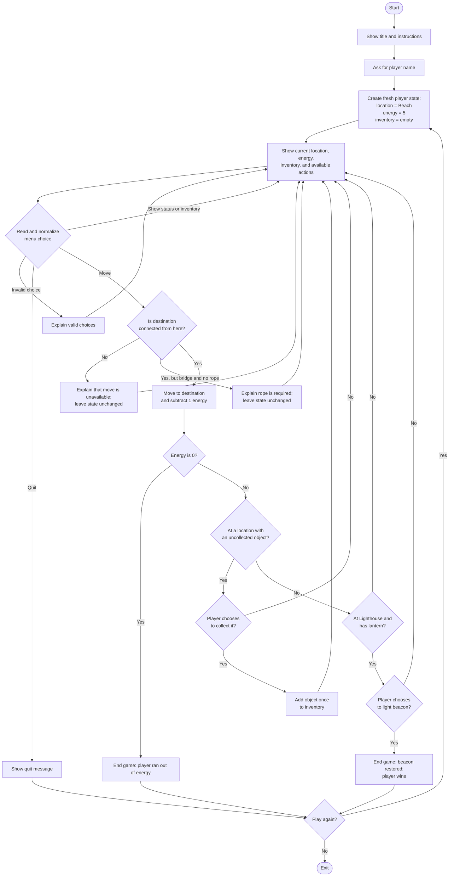

# Mystery Island — Game Flowchart

Use this as a guide while building the game in small parts. The map shows the required locations; choose and document the exact route and where the rope and lantern are found.

## Decisions to settle in your design

- Which locations connect, including any backward moves?
- Which location contains the rope, and which contains the lantern?
- Does choosing to collect an object cost energy, or only moving?
- How does the player choose to light the beacon at the Lighthouse?
- Does quitting offer replay, or exit directly? The chart currently offers replay after quit too.

Keep invalid choices and blocked moves from changing the player's state. A replay should create a new state with 5 energy, Beach as the location, and an empty inventory.
